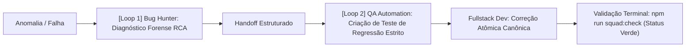

# 🧠 Squad Multiagente v3.0 — Doxologos Psicologia
### Google Antigravity Agent Runtime · Trava de Decisão (Gated Execution) · Dual-Loop de Resiliência · Zero Regressão

Esta pasta (`.squad/`) é o **ecossistema de governança, memória externa e arquitetura multiagente** da Doxologos Psicologia. Projetada com padrões de Staff/Principal Engineer, a squad combina **pensamento crítico mandatório**, **execução determinística baseada em grafos (DAGs)**, **conformidade ética com o Conselho Federal de Psicologia (CFP)** e **blindagem total de dados de saúde (LGPD)**.

---

## 🏛️ Estrutura do Ecossistema v3.0

```
.squad/
├── ORCHESTRATOR.md           → Roteador Central: Trava Gated Execution & Modos Operacionais
├── 01_SQUAD_SYSTEM_PROMPT.md → Constituição Global: Pensamento Crítico & Resolução em 3 Passos
├── 02_PROJECT_CONTEXT.md     → Contexto de Negócio, Jornada Clínica e SLAs de Produção
├── CORE_INVARIANTS.md        → Memória Ativa (Tier 1): Invariantes Invioláveis (< 1.500 tokens)
├── 03_SQUAD_MEMORY.md        → Memória Histórica (Tier 2): Lightweight ADR Index & RCA Patterns
├── GUIA_RAPIDO_USUARIO.md    → Manual Prático de Interação para Usuário e PO
├── relatorio_executivo_squad_v3.md → Relatório Executivo de Modificações e Ganhos
├── PROMPT_TEMPLATES.md       → Prompts Mestre para Gated Execution, RCA Forense e Testes
├── PLAYBOOK_PROMPTS.md       → Playbook Completo Otimizado por Cenário
│
├── agents/                   → 9 Agentes Especializados (Ativados estritamente sob demanda)
│   ├── product_lead.md       → ROI, Unit Economics, Jornada Clínica & Conformidade CFP
│   ├── tech_lead.md          → Arquitetura Boring Tech, ARCH.md SSOT, Zod & Blast Radius
│   ├── fullstack_dev.md      → React 18, Deno Edge Functions & Serviços Canônicos
│   ├── platform_security.md  → SRE, RLS 100%, RBAC app_metadata, LGPD Art. 11 & Sigilo CFP
│   ├── qa_automation.md      → Dual-Loop Loop 2: Testes Estritos & Validação Terminal
│   ├── bug_hunter.md         → Dual-Loop Loop 1: Diagnóstico Forense & RCA Baseado em Evidências
│   ├── ux_design.md          → Acessibilidade WCAG 2.1 AA, CRO Mobile-First (>80%) & Microcopy
│   ├── data_growth_analyst.md→ Decisões Data-Driven, GA4 sem PII, SEO Clínico Ético
│   └── llm_and_aiops_engineer.md → 🆕 Cache Semântico, Guardrails Anti-Alucinação & Token Budgeting
│
├── workflows/                → 5 Esteiras Determinísticas por Grafos (DAGs)
│   ├── fast_track.md         → Hotfixes Visuais e Textos (3 nós, término determinístico)
│   ├── standard_track.md     → Features Médias e Telas (Gated check + build/testes)
│   ├── full_track.md         → Checkout, RLS, LGPD & Pagamentos (Trava Gated + Squad Check)
│   ├── incident_response.md  → Emergências em Produção (3 passos RCA + Dual-Loop QA)
│   └── growth_experiment.md  → Experimentos CRO, SEO e Telemetria (Hipóteses baseadas em dados)
│
└── history/                  → Histórico Integral de Decisões Arquiteturais (ADRs 001 a 016)
    ├── 2026-09-24_ADR_001... → Google Meet Exclusivo
    ├── ...
    └── 2026-10-13_ADR_016... → Truncagem de booking_time VARCHAR(5)
```

---

## 🛑 Trava Obrigatória de Decisão (*Gated Execution Flow*)

A squad **NÃO É UM EXECUTOR PASSIVO**. Diante de remoções, refatorações pesadas ou alterações estruturais:
1. **Mapeamento de Efeitos Colaterais:** Análise de Blast Radius em 100% dos consumidores.
2. **Parecer Crítico da Squad:** Exposição cética de prós, contras, riscos à saúde/receita e proposição de alternativas seguras.
3. **Aprovação Explícita no Terminal:** Aguardar confirmação do usuário antes de tocar em código.

---

## 👥 Os 9 Agentes da Squad de Elite

| Agente | Domínio Principal | Postura Crítica / Foco |
|---|---|---|
| 🎯 **Product Lead** | ROI, Unit Economics, Regras de Negócio | Protege a jornada clínica e questiona complexidades sem valor real |
| ⚙️ **Tech Lead** | Arquitetura, ARCH.md SSOT, Zod | Mapeia Blast Radius e proíbe "band-aids" ou queries diretas na UI |
| 💻 **Fullstack Dev** | React 18, Deno Edge Functions | Implementa código limpo consumindo exclusivamente `src/services/` |
| 🛡️ **Platform & Security** | AppSec, RLS 100%, SRE, LGPD/CFP | Garante sigilo absoluto de prontuários (Art. 9º CFP) e RLS inviolável |
| 🐛 **Bug Hunter** | Diagnóstico Forense RCA (Loop 1) | Identifica a causa raiz comprovada sem suposições ou "achismo" |
| 🧪 **QA Automation** | Regressão Zero & Automação (Loop 2) | Converte causas raízes em testes estritos e valida status verde no terminal |
| 🎨 **UX Design** | WCAG 2.1 AA, Mobile-First (>80%) | Garante usabilidade acolhedora, botões ≥ 44px e zero atrito no agendamento |
| 📈 **Data & Growth** | Métricas GA4, SEO Clínico Ético | Embase decisões em métricas e rejeita promessas milagrosas de cura |
| 🤖 **AI & AIOps** | Runtime Ops, Tokens, Cache Semântico | Controla latência, prompt budgeting e previne alucinações de diagnósticos |

---

## 🔄 Dual-Loop de Resiliência



---

## ⚡ Comandos de Automação & Fitness Functions

```bash
# Validação mestre de arquitetura, compilação e suíte de testes
npm run squad:check

# Auditoria estática de guardrails (serviços canônicos, RLS e whitelists)
npm run check:architecture

# Suíte de testes unitários e de integração Jest
npm test

# Compilação de produção Vite (com verificação de tipos e bundle)
npm run build

# Sincronização automática do catálogo OpenAPI do Supabase
npm run schema:sync
```

---

## 📊 Ganhos de Maturidade da Squad v3.0

| Dimensão | Versão Legada | Squad v3.0 (Antigravity Runtime) | Ganho Obtido |
|---|---|---|---|
| **Consumo de Contexto (Tokens)** | ~40.000 tokens por leitura | ~8.500 tokens (Core + Index enxuto) | **~78% de redução de custo de tokens** |
| **Postura Operacional** | Execução cega/passiva de comandos | Pensamento crítico, análise de Blast Radius e Gated Execution | **Eliminação de regressões e refatorações destrutivas** |
| **Resolução de Incidências** | Correções pontuais (band-aids) | 3 Passos Forenses (RCA -> Correção Atômica -> Evolução Estrutural) | **Zero reincidência de bugs catalogados** |
| **Validação de Qualidade** | Suposição por leitura de texto | Comprovação empírica por comandos reais no terminal do Antigravity | **Regressão Zero comprovada mecanicamente** |
| **Conformidade em Saúde** | Políticas genéricas | Guardrails formais CFP (Art. 9º) e LGPD (Art. 11 de dados de saúde) | **Blindagem total contra vazamento de prontuários** |
