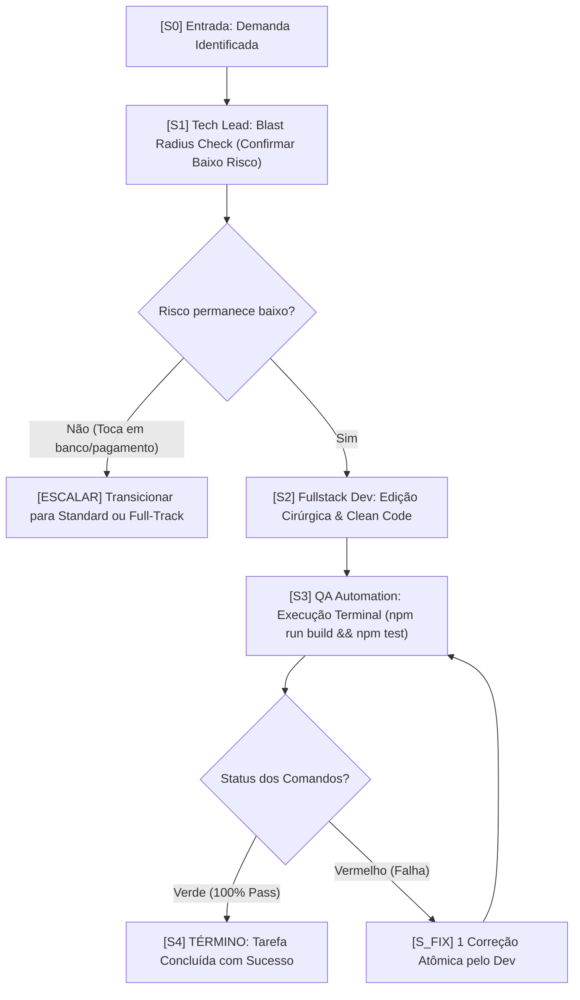

# ⚡ ESTEIRA 1: FAST-TRACK (Hotfixes de UI, Textos e Bugs Simples)
> **Grafo Dirigido de Estados (DAG) | Execução Determinística | Zero Loops Infinitos**

---

## 🎯 1. Aplicabilidade & Critérios de Entrada
Esta esteira é ativada estritamente para tarefas de **baixo risco**, tais como:
- Ajustes de CSS, TailwindCSS, tipografia, cores, padding e responsividade visual.
- Correção de microcopy, ortografia ou banners informativos.
- Bugs simples em componentes React que **NÃO alterem** schemas de banco, rotas de pagamento, RLS ou Edge Functions.

**Agentes Ativos:** `Tech Lead` (Triage) + `Fullstack Dev` (Implementação) + `QA Automation` (Build/Testes).

---

## 🧭 2. Grafo Dirigido de Estados (DAG)



---

## ⚙️ 3. Transições de Estado & Critérios Determinísticos

### Estado S0: Entrada
- Recebe a instrução do usuário.

### Estado S1: Verificação de Impacto (Tech Lead)
- Confirma que nenhum arquivo sob `supabase/functions/`, `src/services/` ou schema de banco é afetado.
- *Condição de Guarda:* Se houver risco transversal oculto, aborta o Fast-Track e migra para **Standard-Track** ou **Full-Track**.

### Estado S2: Execução Cirúrgica (Fullstack Dev)
- Modifica os componentes visuais respeitando TailwindCSS e WCAG 2.1 AA.
- Proibido inlinar lógica de persistência ou queries de banco.

### Estado S3: Validação Empírica (QA Automation)
- Executa no terminal:
  ```bash
  npm run build && npm test
  ```
- *Condição de Término:*
  - Se status verde: Transiciona imediatamente para **S_DONE** (Concluído).
  - Se falha: Executa no máximo 1 ciclo de reparo atômico (**S_FIX**). Persistindo falha, pausa para intervenção do Tech Lead (impede loops infinitos).

---

## 🏁 4. Estado Terminal (Definição de Pronto - DoD)
- [ ] Código editado com precisão cirúrgica.
- [ ] Build e testes unitários concluídos com status verde.
- [ ] Zero impacto em pagamentos, dados de saúde ou rotas sensíveis.
