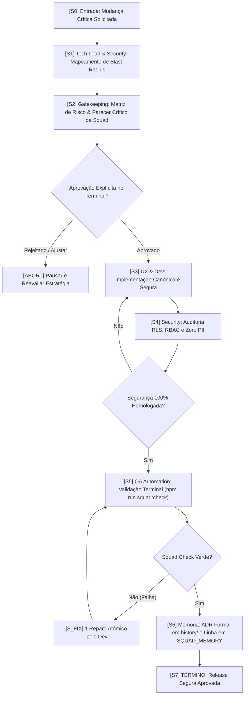

# 🛡️ ESTEIRA 3: FULL-TRACK (Pagamentos, RLS, Segurança & LGPD)
> **Grafo Dirigido de Estados (DAG) | Trava Gated Execution Obrigatória | Zero Regressão**

---

## 🎯 1. Aplicabilidade & Critérios de Entrada
Esta esteira é ativada compulsoriamente para qualquer alteração de **alto risco**, tais como:
- Qualquer alteração no fluxo de checkout Mercado Pago (PIX inline com QR Code, cartão direto).
- Alterações em Edge Functions Deno em `supabase/functions/` (webhooks, integrações, disparos de e-mail).
- Criação ou migração de tabelas, índices e políticas Row Level Security (RLS) no Supabase.
- Manipulação de dados de saúde mental, notas clínicas de sessões ou regras CFP/LGPD (Art. 11).
- Emissão fiscal (NFS-e) e conciliação de pagamentos.

**Agentes Ativos:** `Product Lead` + `Tech Lead` + `Fullstack Dev` + `Platform & Security` + `QA Automation` + `UX Design`.

---

## 🧭 2. Grafo Dirigido de Estados (DAG)



---

## ⚙️ 3. Transições de Estado & Critérios Determinísticos

### Estado S0: Entrada Crítica
- Identificação de impacto financeiro, de privacidade ou de banco de dados.

### Estado S1 & S2: Trava Gated Execution (Tech Lead & Platform Security)
- Mapear 100% dos consumidores de banco e rotas de API.
- Apresentar ao usuário:
  1. *Matriz de Impacto e Blast Radius.*
  2. *Parecer Crítico da Squad (Prós, contras, riscos ocultos e sugestão mais segura).*
- **Trava:** O sistema não avança para o código sem aprovação explícita.

### Estado S3: Construção Canônica (Fullstack Dev & UX Design)
- Implementar as alterações exclusivamente através dos serviços canônicos sob `src/services/`.
- Garantir que `booking_time` mantenha formato `VARCHAR(5)` e que pagamentos utilizem idempotência atômica.
- No frontend, assegurar microcopy acolhedora e acessibilidade WCAG 2.1 AA.

### Estado S4: Auditoria de Segurança e Privacidade (Platform & Security)
- Validar políticas RLS ativas em 100% das tabelas tocadas.
- Confirmar ausência total de PII, senhas ou prontuários em logs ou consoles de navegador.
- Confirmar que Edge Functions utilizam `supabase/functions/_shared/auth.ts` para validação por `app_metadata.role`.

### Estado S5: Comprovação Empírica Dinâmica (QA Automation)
- Executar no terminal do Antigravity:
  ```bash
  npm run squad:check
  ```
  *(Equivalente a: `npm run check:architecture && npm run build && npm test`)*
- *Condição de Término:* Apenas o status 100% verde permite a conclusão. Em caso de falha, permite no máximo 1 ciclo de reparo atômico (**S_FIX**).

### Estado S6: Registro de Memória e Fechamento
- Escrever o arquivo completo da ADR em `.squad/history/YYYY-MM-DD_ADR_XXX_TITULO.md`.
- Adicionar uma linha compacta no **Lightweight ADR Index** em `.squad/03_SQUAD_MEMORY.md`.

---

## 🏁 4. Estado Terminal (Definição de Pronto - DoD)
- [ ] Trava Gated Execution formalizada e aprovada.
- [ ] RLS ativo em 100% das tabelas modificadas.
- [ ] Zero vazamento de PII em logs de Edge Functions ou frontend.
- [ ] Idempotência atômica garantida em pagamentos e webhooks.
- [ ] `npm run squad:check` concluído com status verde total.
- [ ] Nova ADR formal gravada em `.squad/history/` e indexada em `03_SQUAD_MEMORY.md`.
