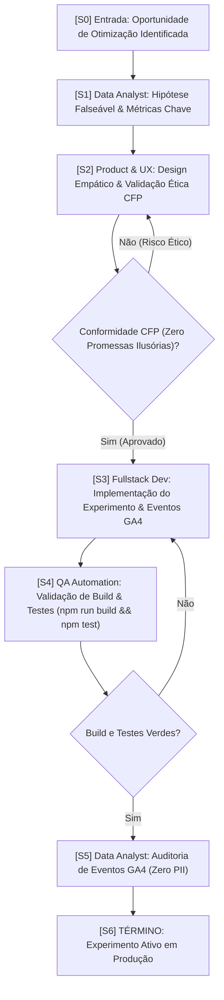

# 📈 ESTEIRA 5: GROWTH & EXPERIMENT (CRO, SEO Clínico & A/B Tests)
> **Grafo Dirigido de Estados (DAG) | Decisões Orientadas a Dados | Governança Ética CFP**

---

## 🎯 1. Aplicabilidade & Critérios de Entrada
Esta esteira é ativada para iniciativas de crescimento, aquisição, retenção e inteligência de mercado:
- Testes A/B em landing pages e fluxos de agendamento.
- Otimização de SEO Clínico (Title, Meta Description, OpenGraph, Schema.org) respeitando normas do CFP (ADR 004).
- Ajustes em réguas de comunicação para redução de faltas (*no-show*) e aumento de retenção (LTV).
- Setup de novos eventos de rastreamento no GA4 sem tráfego de PII.

**Agentes Ativos:** `Data & Growth Analyst` (Líder) + `Product Lead` + `UX Design` + `Fullstack Dev` + `QA Automation`.

---

## 🧭 2. Grafo Dirigido de Estados (DAG)



---

## ⚙️ 3. Transições de Estado & Critérios Determinísticos

### Estado S0: Entrada
- Recebe a oportunidade de crescimento ou análise de funil.

### Estado S1: Hipótese Baseada em Dados (Data & Growth Analyst)
- Formular hipótese estruturada: *"Com base na métrica X, se alterarmos Y, esperamos que a métrica Z varie em W% em N dias."*
- Proibido iniciar experimentos sem métrica primária mensurável.

### Estado S2: Design Empático & Compliance Ético (Product Lead & UX Design)
- Assegurar microcopy empática e acolhedora voltada para a saúde mental.
- **Filtro CFP:** Proibição absoluta de títulos ou copys apelativas ("Cure sua ansiedade em 3 sessões", etc.).

### Estado S3: Implementação Tecnológica (Fullstack Dev)
- Codificar os componentes React com menor atrito possível.
- Disparar eventos no GA4 garantindo que nenhum e-mail, nome ou dado médico do paciente seja trafegado na carga útil.

### Estado S4 & S5: Validação de Qualidade & Telemetria (QA & Data Analyst)
- Executar no terminal:
  ```bash
  npm run build && npm test
  ```
- O Data Analyst audita a coleta no staging/produção para assegurar conformidade com a LGPD.

---

## 🏁 4. Estado Terminal (Definição de Pronto - DoD)
- [ ] Hipótese estruturada documentada com métrica clara de sucesso.
- [ ] Conteúdo e copys em 100% de conformidade com as regras éticas do CFP.
- [ ] Zero dados de saúde ou PII enviados ao Google Analytics.
- [ ] Compilação de produção e testes unitários 100% verdes no terminal.
