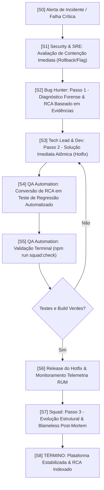

# 🚨 ESTEIRA 4: INCIDENT RESPONSE (Crises, Quedas & Bugs Críticos em Produção)
> **Grafo Dirigido de Estados (DAG) | Metodologia Forense em 3 Passos | Dual-Loop de Resiliência**

---

## 🎯 1. Aplicabilidade & Critérios de Entrada
Esta esteira é ativada em **situações de emergência em produção** que impactem a receita, a integridade de dados ou o atendimento clínico:
- Checkout Mercado Pago com taxa de rejeição anômala ou fora do ar.
- Falha na geração de links dinâmicos do Google Meet ou entrega de e-mails de consulta.
- Queda geral de disponibilidade, erros HTTP 500 recorrentes ou regressões pós-deploy.
- Suspeita de vazamento de dados ou violação de segurança/RLS.

**Agentes Ativos:** `Bug Hunter` (Líder Forense) + `Platform Security` (Contenção) + `Tech Lead` + `Fullstack Dev` + `QA Automation` (Loop de Regressão).

---

## 🧭 2. Grafo Dirigido de Estados (DAG)



---

## ⚙️ 3. Transições de Estado & Protocolo Forense em 3 Passos

### Estado S0 & S1: Alerta e Contenção (Platform Security)
- Avaliar a gravidade do incidente.
- Se houver perda contínua de receita ou risco de dados, acionar feature flag ou rollback imediato antes de alterar código.

### Estado S2: Passo 1 - Diagnóstico Forense (Bug Hunter)
- *Princípio Silent Diagnosis First:* Proibido palpitar ou propor código sem evidências concretas.
- Rastrear logs de Edge Functions, telemetria RUM e consoles de erro.
- Confirmar a Causa Raiz real (*Root Cause*), isolando-a do sintoma superficial.
- Emitir o Handoff Forense detalhado para o Tech Lead e QA Automation.

### Estado S3: Passo 2 - Solução Imediata (Tech Lead & Fullstack Dev)
- Escrever a correção cirúrgica estritamente necessária para restaurar a operação com 100% de segurança.
- Manter o patch mínimo, sem introduzir refatorações paralelas desnecessárias no momento da crise.

### Estado S4 & S5: Dual-Loop QA & Validação Dinâmica (QA Automation)
- Codificar imediatamente um teste automatizado Jest ou Playwright que falharia com o bug e passa com o hotfix.
- Executar os testes via terminal:
  ```bash
  npm run squad:check
  ```
- *Condição de Término:* Apenas status 100% verde autoriza o deploy do hotfix.

### Estado S6 & S7: Passo 3 - Evolução Estrutural & Post-Mortem (Toda a Squad)
- Monitorar a telemetria pós-release via RUM (`rumMonitoring.js`).
- Formular e implementar a melhoria estrutural permanente (guardrails no CI, ajuste em schemas, validação Zod adicional) para que a falha nunca mais se repita.
- Documentar no RCA Pattern Index de `.squad/03_SQUAD_MEMORY.md`.

---

## 🏁 4. Estado Terminal (Definição de Pronto - DoD)
- [ ] Operação crítica restaurada e validada em produção.
- [ ] Causa raiz comprovada empiricamente e documentada.
- [ ] Teste automatizado de regressão codificado e rodando no pipeline.
- [ ] `npm run squad:check` com status verde no terminal.
- [ ] Melhoria estrutural permanente planejada/implantada.
