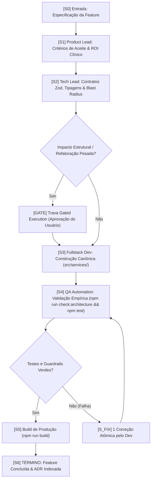

# 📦 ESTEIRA 2: STANDARD-TRACK (Features Médias & Telas)
> **Grafo Dirigido de Estados (DAG) | Execução Determinística | Zero Loops Infinitos**

---

## 🎯 1. Aplicabilidade & Critérios de Entrada
Esta esteira é ativada para funcionalidades de **médio porte**, tais como:
- Criação ou evolução de telas, modais ou abas na Área do Paciente ou Painel do Profissional.
- Criação de novos hooks de leitura no Supabase via TanStack Query.
- Novos componentes de interface reutilizáveis (Radix UI / shadcn/ui).
- Validação de novos formulários clínicos ou cadastrais com Zod.

**Agentes Ativos:** `Product Lead` + `Tech Lead` + `Fullstack Dev` + `QA Automation`.

---

## 🧭 2. Grafo Dirigido de Estados (DAG)



---

## ⚙️ 3. Transições de Estado & Critérios Determinísticos

### Estado S0: Entrada
- Recebe a especificação da feature média.

### Estado S1: Alinhamento de Negócio & Ética (Product Lead)
- Valida os critérios de aceite focados na jornada do paciente/psicólogo.
- Assegura linguagem acolhedora e conformidade com o CFP (sem promessas falsas).

### Estado S2: Arquitetura & Contratos (Tech Lead)
- Define os contratos Zod e os hooks TanStack Query necessários em `src/hooks/queries/`.
- Mapeia o Blast Radius. Se houver deleção ou mudança em contratos existentes, aciona a **Trava Gated Execution**.

### Estado S3: Construção Canônica (Fullstack Dev)
- Constrói a feature consumindo estritamente os serviços canônicos sob `src/services/`.
- Aplica whitelists de campos (`ALLOWED_FIELDS`) validados contra `databaseCatalog.json`.

### Estado S4 & S5: Validação de Qualidade & Build (QA Automation)
- Executa no terminal:
  ```bash
  npm run check:architecture && npm test && npm run build
  ```
- *Condição de Término:* Status verde em todas as etapas conclui a esteira (**S_DONE**).
- *Condição Anti-Loop:* No máximo 1 ciclo de reparo atômico (**S_FIX**). Persistindo falha, pausa a execução com relatório forense.

---

## 🏁 4. Estado Terminal (Definição de Pronto - DoD)
- [ ] Componente ou tela conectado exclusivamente aos serviços canônicos.
- [ ] Whitelist de campos aplicada contra schema drift.
- [ ] Guardrails de arquitetura, testes e build 100% verdes no terminal.
- [ ] Registro resumido no Lightweight ADR Index de `03_SQUAD_MEMORY.md` caso novo padrão tenha sido introduzido.
